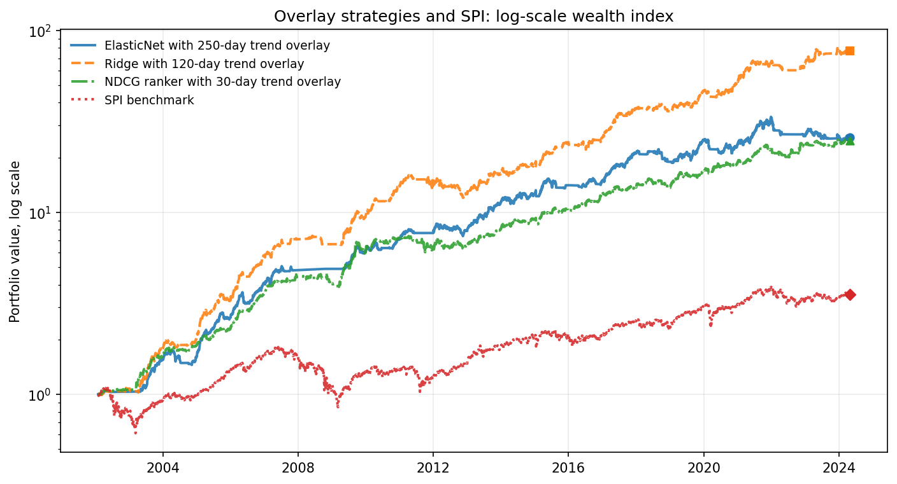
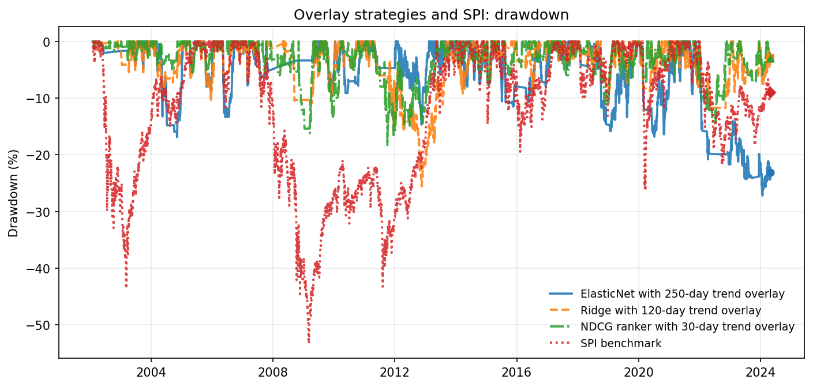

# Swiss Equity Portfolio Backtests

Marcel Blagotinsek

A Python backtesting and portfolio optimisation framework applied to Swiss equities, with a library of strategies and an ML stock-selection study. The framework covers universe selection, return and risk estimation, constrained quadratic optimisation and cost-aware simulation. The notebooks use it to test rule-based and machine-learning strategies against the Swiss Performance Index (SPI).

## Headline project: Swiss Equity Machine-Learning Strategies with Trend-Based Risk Control

**Research question.** Can point-in-time ML stock-selection signals improve risk-adjusted performance after transaction costs, and how much of the gain comes from stock selection versus market-exposure control?

| Strategy | CAGR | Volatility | Sharpe | Max drawdown | Information ratio vs SPI |
| --- | ---: | ---: | ---: | ---: | ---: |
| ElasticNet with 250-day trend overlay | 14.92% | 11.19% | 1.30 | -27.57% | 0.47 |
| Ridge with 120-day trend overlay | 20.51% | 11.64% | 1.66 | -25.57% | 0.73 |
| NDCG ranker with 30-day trend overlay | 14.75% | 10.22% | 1.39 | -18.45% | 0.49 |
| SPI benchmark | 5.56% | 16.47% | 0.41 | -53.25% | |

Returns are net of costs. Configurations were selected on the full backtest sample; the report tests their sensitivity to parameter choices, but the figures are not an out-of-sample estimate.

**Main finding.** Market-exposure control is the main risk-management mechanism: for ElasticNet, the trend overlay raises the Sharpe ratio from 0.74 to 1.30 and improves maximum drawdown from -59.19% to -27.57%. Differences between the stock-selection models are secondary but still economically relevant, with Ridge having the highest Sharpe ratio and the NDCG ranker the smallest maximum drawdown.





**Full report:** [report/swiss_equity_ml_report.html](report/swiss_equity_ml_report.html). GitHub shows HTML files as source, so download the file and open it in a browser.

## How the backtests work

- **Rebalancing:** quarterly, on dates taken from the JKP data calendar.
- **Point-in-time signals:** stock characteristics enter with a 90-day reporting lag. The ML models in [signals/ml_signal.py](signals/ml_signal.py) train only on the past 36 rebalancing periods, with realised returns between earlier rebalancing dates as labels.
- **Constrained long-only optimisation:** scores go into a mean-variance style optimiser with a risk aversion parameter, a turnover penalty, a budget constraint and a maximum stock weight. The ML sweeps test risk aversion of 1, 10, 50 and 200, turnover penalties of 0, 0.1, 0.25 and 0.5, and maximum weights of 5%, 10%, 15% and 20%.
- **Transaction costs:** 1% per year fixed and 0.2% variable on turnover.
- **Swiss risk-free rate:** the monthly Swiss call-money rate, converted to a daily series in [data_utils/swiss_rf.py](data_utils/swiss_rf.py). It is the Sharpe ratio hurdle and the return on capital held outside equities.
- **Benchmark:** the SPI total return index. The information ratio is measured against it.
- **Trend overlay:** applied after the stock portfolio is formed. When the lagged SPI price is below its moving average (windows of 30 to 400 days are tested), the equity sleeve moves to the risk-free rate.

## Strategy library

| Strategy | Idea | Notebook |
| --- | --- | --- |
| Defensive Quality Compounder | Screens on liquidity, profitability, leverage, volatility and quality, then uses long-only minimum-variance weights | [01](strategies/01_defensive_quality_compounder.ipynb) |
| Low-Volatility Minimum-Variance Core | Liquid stocks with low trailing volatility, long-only minimum-variance weights | [02](strategies/02_low_vol_min_variance.ipynb) |
| Momentum with Crash Control | Top momentum stocks excluding high-volatility and high-beta names, inverse-volatility weights | [03](strategies/03_momentum_crash_control.ipynb) |
| Quality-at-Reasonable-Price | Quality-approved stocks with acceptable valuation, inverse-volatility weights | [04](strategies/04_quality_at_reasonable_price.ipynb) |
| Value Trap Avoidance | Cheap stocks after profitability, leverage, distress, liquidity and momentum filters, inverse-volatility weights | [05](strategies/05_value_trap_avoidance.ipynb) |
| Defensive Income | Dividend payers with sustainability and risk filters, risk-weighted inverse-volatility weights | [06](strategies/06_defensive_income.ipynb) |
| Conservative Investment / Profitability | Profitable stocks with controlled investment growth, leverage, liquidity and volatility | [07](strategies/07_conservative_investment_profitability.ipynb) |
| Swiss Small-Cap Quality | Smaller stocks with liquidity, profitability, quality and volatility controls | [08](strategies/08_swiss_small_cap_quality.ipynb) |
| Trend-Following Equity Exposure | Liquid equity basket with a monthly SPI moving-average exposure overlay | [09](strategies/09_trend_following_equity_exposure.ipynb) |
| Drawdown-Controlled Portfolio | Liquid equity basket with a monthly SPI drawdown exposure overlay | [10](strategies/10_drawdown_controlled_portfolio.ipynb) |
| Risk-Parity Swiss Equity | Shrinkage covariance with approximately equal risk contributions | [11](strategies/11_risk_parity_swiss_equity.ipynb) |
| Machine-Learning Smart Beta | Minimum-variance portfolio with an ML rank tilt and a no-trade band, with a sweep over the band parameters | [notebook](strategies/ml_smart_beta_no_trade_band_sweep.ipynb) |
| Regime-Aware ML Allocator | Daily ML rank signal combined with SPI regimes and next-regime forecasts; the saved run stopped at configuration 2 of 9 of the allocation test | [notebook](strategies/regime_aware_ml_allocator.ipynb) |

## ML stock selection

| Notebook | Content |
| --- | --- |
| [model_sweeps_elasticnet](ml_stock_selection/model_sweeps_elasticnet.ipynb) | 64-point parameter grid and overlay window tests for ElasticNet |
| [model_sweeps_ridge](ml_stock_selection/model_sweeps_ridge.ipynb) | The same grid for Ridge |
| [model_sweeps_ranker_ndcg](ml_stock_selection/model_sweeps_ranker_ndcg.ipynb) | The same grid for the NDCG ranker |
| [allocation](ml_stock_selection/allocation.ipynb) | Compares saved sweep portfolios with and without the overlay |
| [causal_backtest](ml_stock_selection/causal_backtest.ipynb) | Ridge grid with strategy selection on a validation period ending in 2016 and a separate test period; the saved run covers 30 of 36 variants |

## Use cases

- [01 QP solver comparison and minimum variance](use_cases/01_qp_solver_comparison_and_min_variance.ipynb): compares open-source QP solvers and adds a closed-form minimum-variance solution.
- [02 Linearised turnover constraint](use_cases/02_linearized_turnover_constraint.ipynb): rewrites an L1 turnover limit as linear constraints in the quadratic program.
- [03 Maximum Sharpe backtest with turnover penalty](use_cases/03_max_sharpe_backtest_with_turnover_penalty.ipynb): approximates the maximum Sharpe portfolio iteratively and backtests it at about 100% annual turnover.
- [04 Factor theme portfolios and regression](use_cases/04_factor_theme_portfolios_and_regression.ipynb): builds long-short factor series from quintile portfolios and regresses a factor mix on them and the SPI.

## Repository structure

```
framework/            backtesting, optimisation, estimation and ML modules
signals/              ML stock-selection signal (ml_signal.py)
data_utils/           Swiss risk-free rate helper (swiss_rf.py)
use_cases/            notebooks demonstrating framework features
strategies/           single-strategy backtests
ml_stock_selection/   model sweeps, allocation comparison, causal backtest
report/               final report, assets and build script
data/                 place data files here (see data/README.md)
```

## Install and run

Python 3.12 or later. With [uv](https://docs.astral.sh/uv/):

```bash
uv venv
uv pip install -r requirements.txt
```

Or with pip:

```bash
python -m venv .venv
.venv/Scripts/activate      # Windows; on Linux or macOS: source .venv/bin/activate
pip install -r requirements.txt
```

Then start Jupyter from the repository root and open any notebook. Notebooks find the repository root on their own and add `framework/`, `signals/` and `data_utils/` to the Python path.

```bash
jupyter lab
```

Saved outputs can be read without any data. To re-run a notebook, put the data files in `data/`: [data/README.md](data/README.md) lists each file, its format and its source. A notebook stops with a message naming any missing file.

To rebuild the report, run the three model sweep notebooks and then `python report/build_report.py`. This writes `report/swiss_equity_ml_report_rebuilt.html`, which links to images in `report/assets/`.
